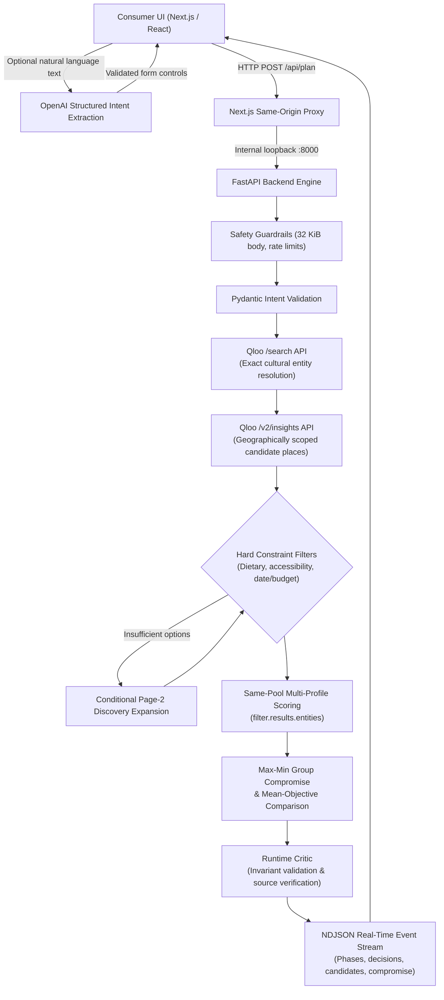

# TastePilot AI

**Cultural intelligence that turns personal taste into real-world group experiences.**

[](https://heroku.com/deploy?template=https://github.com/leninathikam/tastepilot-ai)
[](LICENSE)

TastePilot connects named cultural favorites—music artists, films, books, and brands—to real-world place discovery through Qloo's cultural intelligence API. It enables groups of friends or travel companions to discover shared destinations, enforces practical constraints (budget, dietary, accessibility), and uses a deterministic max-min fairness optimizer to negotiate compromises that everyone can enjoy.

- **Live Application:** [https://tastepilot-ai-43e15cc919d5.herokuapp.com/](https://tastepilot-ai-43e15cc919d5.herokuapp.com/)
- **Repository:** [https://github.com/leninathikam/tastepilot-ai](https://github.com/leninathikam/tastepilot-ai)

---

## Architecture & System Flow

TastePilot uses a deterministic, controlled processing pipeline rather than an unconstrained multi-agent loop. Every phase produces typed, validated events streamed to the UI in real time via NDJSON.



### Key Workflow Steps

1. **Entity Resolution (`/search`)**: Maps user-entered seeds (e.g., *Radiohead*, *Japanese Breakfast*, *Past Lives*) to unambiguous Qloo entity IDs.
2. **Candidate Generation (`/v2/insights`)**: Discovers cultural places within the requested destination city (e.g., Chicago) using location filters.
3. **Hard Constraint Filtering**: Strictly excludes any candidate violating explicit dietary, accessibility, or budget limits.
4. **Conditional Expansion**: Triggers at most one additional insights page if eligible candidates are scarce.
5. **Multi-Profile Same-Pool Scoring**: Queries Qloo with `filter.results.entities` for each companion against the identical candidate set to obtain personalized ranking signals without cross-query bias.
6. **Max-Min Group Compromise**: Evaluates candidate subsets to maximize the lowest-scoring member's best-stop coverage, comparing against a standard mean-preference objective and a no-taste ablation.
7. **Runtime Critic & Streaming**: Enforces budget bounds, deduplication, and source provenance, then streams live progress and decisions back to the browser.

---

## Core Capabilities

- **Multi-Member Taste Negotiation**: Supports up to 4 distinct companion profiles. Provides transparent tradeoff tables showing who each stop serves.
- **Strict Constraint Enforcement**: Fails closed on missing or unverified facts (e.g., unverified wheelchair accessibility or unknown dietary status).
- **Interactive Replanning**: One-click "Make it cheaper" (retaining taste preferences while cutting budget) or selective stop replacement.
- **Input-Driven Taste DNA**: Visual breakdown of categories and interests based strictly on user inputs.
- **Optional Natural-Language Interpreter**: Schema-constrained OpenAI extraction to populate typed controls without giving the LLM execution privileges.
- **Dual Operating Modes**:
  - `live`: Direct integration with live Qloo endpoints and optional OpenAI extraction.
  - `fixture`: Fully offline, reproducible test scenarios with authored Chicago venues.

---

## Quickstart (Local Development)

### Prerequisites
- Node.js 20+
- Python 3.12+

### 1. Backend Setup
```powershell
# Create and activate virtual environment
python -m venv .venv
.\.venv\Scripts\Activate.ps1

# Install dependencies
pip install -r backend/requirements.txt

# Configure environment
Copy-Item .env.example .env
```

Edit `.env` with your API keys:
```env
QLOO_API_KEY=your_qloo_key
QLOO_API_URL=https://hackathon.api.qloo.com
OPENAI_API_KEY=your_openai_key  # Optional
DATA_MODE=live
```

Start the FastAPI backend:
```powershell
python -m uvicorn backend.app.main:app --host 127.0.0.1 --port 8000
```

### 2. Frontend Setup
In another terminal:
```powershell
cd frontend
npm ci
npm run dev
```

Open [http://localhost:3000](http://localhost:3000) in your browser.

---

## Testing & Verification

```powershell
# Backend unit & integration test suite (53 tests)
python -m pytest backend/tests -q

# Bounded live API probe (verifies Qloo connectivity and entity resolution)
python -m evaluation.live_probe --execute

# Frontend component tests
cd frontend
npm test

# Production build test
npm run build

# End-to-end browser smoke test (requires running app)
node ../scripts/judge_smoke.cjs
```

---

## Production Deployment (Heroku)

TastePilot packages the Next.js frontend and FastAPI backend into a single container managed by [`scripts/serve.py`](scripts/serve.py) on a single assigned Heroku port.

Deploy directly using the one-click button:

[](https://heroku.com/deploy?template=https://github.com/leninathikam/tastepilot-ai)

Required Heroku Config Vars:
- `DATA_MODE`: `live`
- `QLOO_API_KEY`: Server-side Qloo API token
- `QLOO_API_URL`: `https://hackathon.api.qloo.com`
- `OPENAI_API_KEY`: *(Optional)* OpenAI key for natural language interpretation

---

## License

This project is open-source under the [MIT License](LICENSE).
