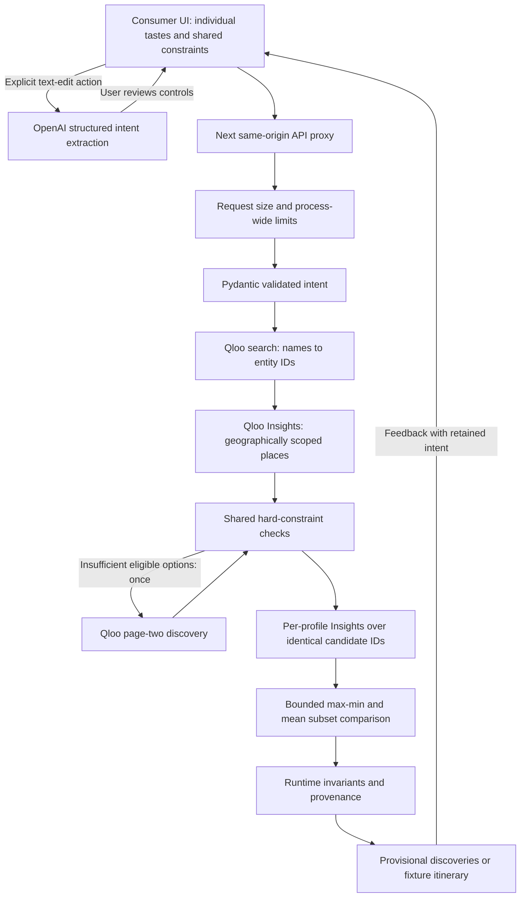

# Architecture

Important limitation: no step independently verifies opening hours, prices or bookings. The fixture adapter is a separately selected synthetic data source, never an automatic fallback from live failure.

Group branch: resolve organizer plus up to three companions, discover a pooled set, enforce shared hard requirements, conditionally fetch one more page, retrieve each member's ordering over the same candidate IDs, then enumerate bounded subsets. Max-min best-stop coverage is compared with mean-coverage and no-taste objectives. Missing member evidence remains unknown, conservatively zero. Maximum pool is 20 and maximum stops six. Groups with unknown costs get a separately labeled provisional shortlist; it is never declared budget-compliant. Runtime critic checks source, duplicates, hard requirements and cost; plan timeout is 60 seconds. The system remains a controlled tool pipeline, not a collection of autonomous LLM agents.

Next.js App Router client -> same-origin /api proxy -> FastAPI -> typed intent -> Qloo adapter -> constraint validator -> deterministic ranking -> bounded critic -> explanations. NDJSON stream emits completed backend phases and final result; no simulated progress timers. State is request-scoped; revision resubmits full typed intent preserving preferences.

No LangGraph dependency: a bounded explicit pipeline provides sufficient control for this release. Optional LLM intent extraction uses schema validation; manual form remains authoritative. External descriptions cannot invoke tools. All evidence stays typed, source-labeled and untrusted.

Ranking: configurable nonnegative taste and explicit-interest weights, normalized by weight sum. Taste = 1 - ordinal/(N-1), or 1 for singleton, only within a single insights response. Tag alignment = matched explicit interests / number of explicit interests. Removing taste uses identical candidates, constraints and tie-breaking. This is a ranking ablation, not an LLM-only benchmark.

Hard requirements reject unknown or false accessibility/dietary/date evidence. Unknown costs cannot enter a confirmed budget-constrained plan. They may appear separately as provisional discoveries. Synthetic fixture facts satisfy only a simulation, never real-world verification. Aggregate budget is per-person costs multiplied by party size; no fabricated travel estimates.
